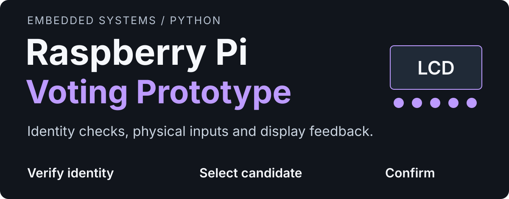
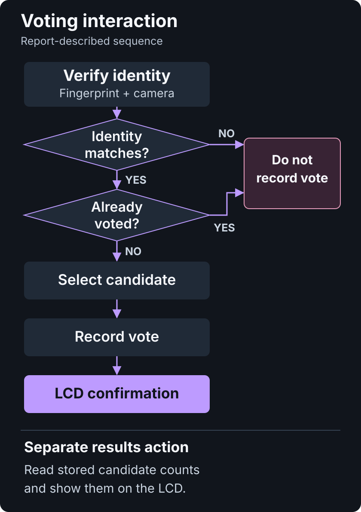

# Raspberry Pi Voting Prototype

A physical voting-machine prototype combining fingerprint verification, a camera-based identity check, button inputs and a local results display.

 

## Contents

- [Project Summary](#project-summary)
- [Voting Flow](#voting-flow)
- [Prototype Gallery](#prototype-gallery)
- [Engineering Work](#engineering-work-shown)

<table>
<tr><td width="50%"></td><td width="50%"></td></tr>
<tr><td>Vote confirmation on the assembled prototype</td><td>Candidate count on the local display</td></tr>
</table>

## Project Summary

The prototype brings sensor input, identity checks and a physical voting interface into one Raspberry Pi application. The voting flow combines a fingerprint check with camera-based face verification before accepting a candidate-button input. An LCD guides the user through the process and displays confirmation.

The work connects identity-checking steps to a physical interaction: the person verifies their identity, chooses a candidate and receives confirmation on the display. The report and photographs make the assembled hardware and its feedback screens visible.

## Voting Flow

1. Start the identity-checking sequence.
2. Match the fingerprint and perform the camera-based face check.
3. Check whether the person has already voted.
4. Accept a candidate-button selection and record the vote.
5. Show confirmation, with a separate interaction for displaying results.

The report illustrates the repeat-vote check in its results section. The [technical guide](docs/engineering.md) explains the hardware interfaces, storage approach and supporting evidence.

## Prototype gallery

| Fingerprint prompt | Tamper-alert screen |
|---|---|
|  |  |

| Enclosure and side profile |
|---|
|  |

These photographs show the constructed enclosure, LCD, buttons and fingerprint scanner. The report explains the associated interaction and application logic.

## Engineering work shown

- Coordinating physical inputs, a serial sensor and an LCD through Python on Raspberry Pi.
- Connecting identity-checking steps to a device interaction sequence.
- Recording selections and displaying local results in an academic prototype.
- Documenting hardware work with a report, code excerpt and photographs.

## Read the evidence

The [original report](EVM%20Report.pdf), dated **2 May 2023**, contains design context, flow diagrams, result screens, equipment and the code appendix. It also discusses wider online-voting ideas; these should be distinguished from the physical prototype preserved here.

[**Open the technical guide for components, interaction sequencing and report context →**](docs/engineering.md)

