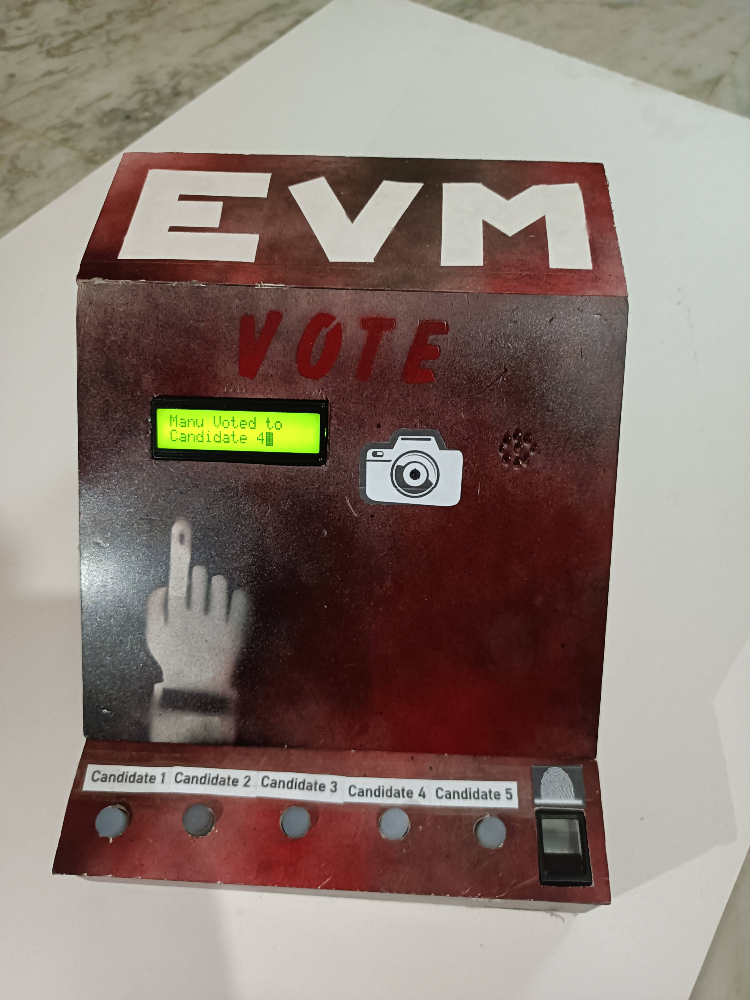
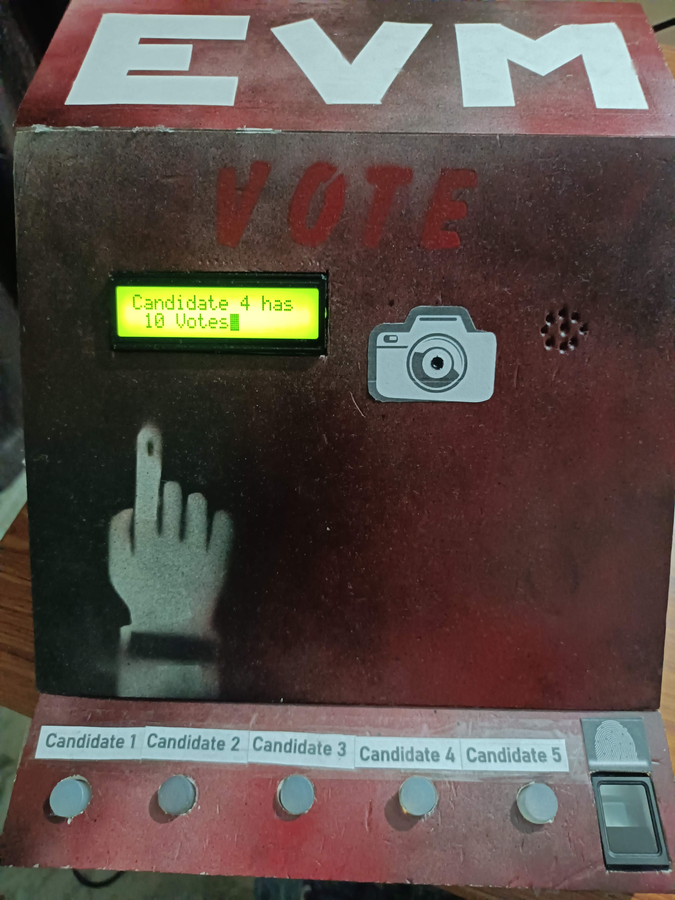
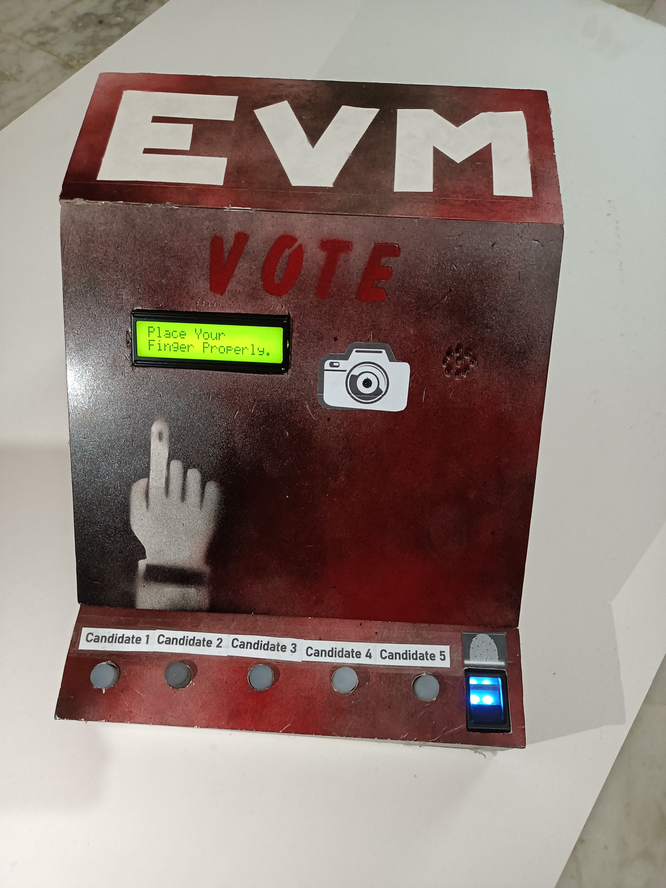
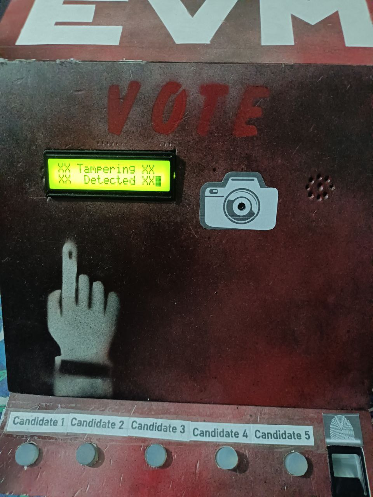
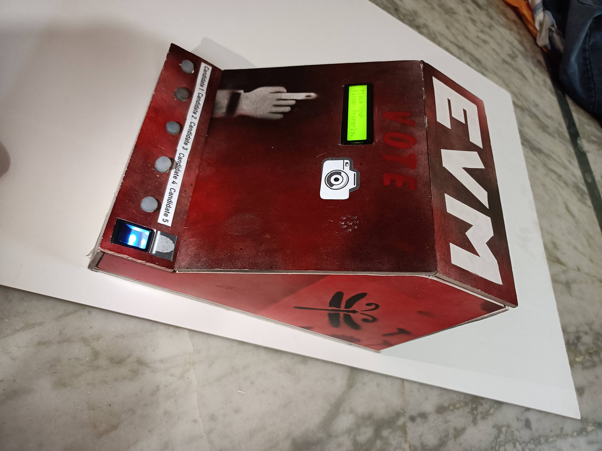

# Raspberry Pi Voting Prototype

A physical voting-machine prototype combining fingerprint verification, a camera-based identity check, button inputs and a local results display.

[Project report](EVM%20Report.pdf) · [Technical notes](docs/technical-notes.md) · [Reproduction status](docs/reproduction.md)

<table>
<tr><td width="50%"></td><td width="50%"></td></tr>
<tr><td>Vote confirmation on the assembled prototype</td><td>Candidate count on the local display</td></tr>
</table>

## Overview

The prototype brings sensor input, identity checks and a physical voting interface into one Raspberry Pi application. The voting flow combines a fingerprint check with camera-based face verification before accepting a candidate-button input. An LCD guides the user through the process and displays confirmation.

This repository preserves the academic report and photographs of the assembled prototype. The report includes an illustrative Python code appendix and example screens. A complete runnable source tree is not included in this checkout.

## Voting flow

1. Start the identity-checking sequence.
2. Match the fingerprint and perform the camera-based face check.
3. Check whether the person has already voted.
4. Accept a candidate-button selection and record the vote.
5. Show confirmation, with a separate interaction for displaying results.

The report illustrates the repeat-vote check in its results section. Its appendix references external face-recognition code that is absent here, so the full flow cannot be reconstructed from this checkout alone.

## Hardware and software

| Part | Role |
|---|---|
| Raspberry Pi 4 | Coordinates the prototype and GPIO devices |
| R307 fingerprint scanner | Fingerprint capture and matching |
| Raspberry Pi camera | Input for the face-verification flow |
| L1602 / 16×2 LCD | Prompts, confirmation and results |
| Five candidate buttons | Physical selection inputs |
| Speaker/buzzer and wiring | User feedback and connections |
| Python, GPIO and serial libraries | Application logic and device interfaces |

The code appendix uses JSON for vote counts and references a separate `Face_Recog` module. See the [technical notes](docs/technical-notes.md) for dependencies and missing pieces.

## Prototype gallery

| Fingerprint prompt | Tamper-alert screen |
|---|---|
|  |  |

| Enclosure and side profile |
|---|
|  |

These photographs show the constructed enclosure, LCD, buttons and fingerprint scanner. The tamper-alert photograph establishes a displayed alert; it is not proof that stored votes are tamper-proof or encrypted.

## Engineering work shown

- Coordinating physical inputs, a serial sensor and an LCD through Python on Raspberry Pi.
- Connecting identity-checking steps to a device interaction sequence.
- Recording selections and displaying local results in an academic prototype.
- Documenting hardware work with a report, code excerpt and photographs.

## Read the evidence

The [original report](EVM%20Report.pdf), dated **2 May 2023**, contains design context, flow diagrams, result screens, equipment and the code appendix. It also discusses wider online-voting ideas; these should be distinguished from the physical prototype preserved here.

This is an academic demonstration, not a certified election system. No independent security evaluation or biometric accuracy benchmark is provided. The [reproduction notes](docs/reproduction.md) explain what is needed to run and evaluate it again.

